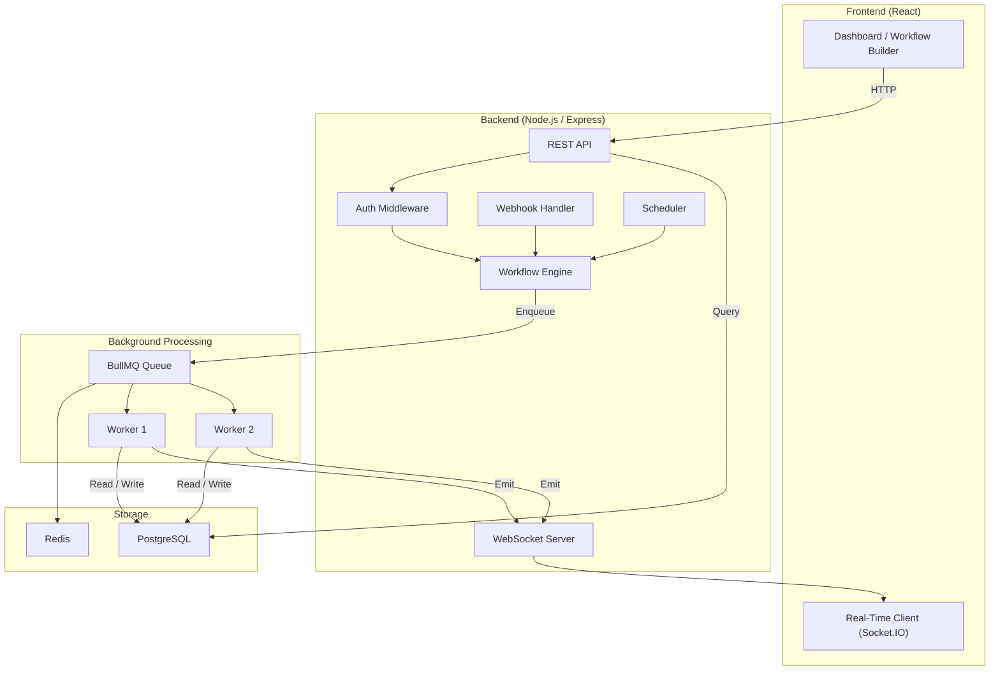

# FlowForge

> A full-stack workflow automation platform built to explore modern web application architecture and backend engineering concepts.

---

## Table of Contents

- [Overview](#overview)
- [The Problem It Solves](#the-problem-it-solves)
- [How It Works](#how-it-works)
- [Example Workflow](#example-workflow)
- [Planned Features](#planned-features)
- [Tech Stack](#tech-stack)
- [System Architecture](#system-architecture)
- [Project Structure](#project-structure)
- [Development Roadmap](#development-roadmap)
- [Current Status](#current-status)
- [Contributors](#contributors)
- [License](#license)

---

## Overview

**FlowForge** is a full-stack, event-driven workflow automation platform. Users define automated workflows using a simple model:

```
WHEN [trigger] → IF [condition] → DO [action(s)]
```

Users create, configure, activate, pause, and monitor workflows through a web dashboard. When a trigger event fires — a webhook, a form submission, or a scheduled time — the backend identifies matching active workflows, queues an execution job, and processes each step through a background worker.

This project is inspired by tools like Zapier, Make, and n8n, but is intentionally scoped smaller. The focus is on building something well-structured and learning how the moving parts of a real full-stack application fit together.

---

## The Problem It Solves

Applications often need to react to events: send a welcome email when a user signs up, create a task when a form is submitted, notify someone when something goes wrong. Hardcoding these reactions inside application logic leads to tightly coupled, difficult-to-maintain code.

FlowForge separates **event detection** from **action execution**:

- A single place to define what should happen and when.
- Actions execute asynchronously via a job queue, without blocking the main application.
- Every execution is logged so you can see what ran, when, and whether it succeeded.

---

## How It Works

1. A user registers and logs in.
2. The user creates a **workflow** consisting of:
   - A **trigger** — the event that starts execution (webhook, form submission, schedule).
   - Optional **conditions** — logical checks that determine whether to proceed.
   - One or more **actions** — operations to perform (send email, HTTP request, create record).
3. The workflow is saved to the database and set to **active**.
4. When a matching event occurs, the backend creates a **workflow execution** and enqueues it as a job.
5. A **background worker** picks up the job and processes each step in sequence, with retry logic on failure.
6. Execution results and logs are stored, and the frontend displays real-time status updates.

---

## Example Workflow

```
Trigger:   New user signs up
                │
                ▼
Condition: Is the user's plan "Pro"?
                │
         ┌──────┴──────┐
        Yes             No
         │               │
         ▼               ▼
   Send Pro          Send standard
   welcome email     welcome email
         │               │
         └──────┬─────────┘
                │
                ▼
        Create onboarding task
                │
                ▼
        Send Slack notification
```

---

## Planned Features

> **Note:** No application code has been written yet. All items below are planned.

### Authentication & Authorization
- [ ] User registration and login
- [ ] JWT-based session management
- [ ] Protected routes (frontend and backend)
- [ ] Role-based authorization

### Workflow Management
- [ ] Workflow CRUD
- [ ] Visual workflow builder
- [ ] Trigger, condition, and action configuration
- [ ] Workflow activation and pausing

### Execution Engine
- [ ] Workflow execution on trigger event
- [ ] Background job processing via BullMQ and Redis
- [ ] Sequential step execution
- [ ] Retry and failure handling
- [ ] Execution status tracking

### Triggers (Initial Set)
- [ ] User signup
- [ ] Form submission
- [ ] Inbound webhook
- [ ] Scheduled / cron

### Actions (Initial Set)
- [ ] Send email
- [ ] Send in-app notification
- [ ] Create a database record
- [ ] Outbound HTTP request

### Observability
- [ ] Execution history per workflow
- [ ] Step-level execution logs
- [ ] Real-time status updates via WebSocket

---

## Tech Stack

| Layer | Technology |
|---|---|
| Frontend | React, JavaScript, React Router |
| Backend | Node.js, Express.js |
| Database | PostgreSQL |
| Job Queue | BullMQ, Redis |
| Real-Time | Socket.IO / WebSockets |
| Auth | JWT |
| API Style | REST |

---

## System Architecture



---

## Project Structure

> Provisional layout — will evolve as development progresses.

```
flowforge/
├── client/                    # React frontend
│   └── src/
│       ├── api/               # API client functions
│       ├── components/        # Reusable UI components
│       ├── pages/             # Route-level pages
│       ├── context/           # React context providers
│       ├── hooks/             # Custom hooks
│       └── utils/
│
├── server/                    # Node.js / Express backend
│   ├── config/                # DB, Redis, env config
│   ├── controllers/           # Route handlers
│   ├── middleware/            # Auth, validation, error handling
│   ├── models/                # Database query functions
│   ├── routes/                # Express route definitions
│   ├── services/              # Business logic
│   ├── workers/               # BullMQ background workers
│   ├── queues/                # Queue definitions
│   ├── triggers/              # Trigger handlers
│   ├── actions/               # Action handlers
│   └── utils/
│
├── .env.example
├── .gitignore
├── package.json
└── README.md
```

---

## Development Roadmap

### Phase 1 — Foundation
- Project scaffolding
- PostgreSQL schema design
- User authentication (register, login, JWT)
- Basic Express API structure
- Protected routes

### Phase 2 — Workflow Engine
- Workflow CRUD API
- Workflow data model (trigger, conditions, actions stored as JSON)
- Manual workflow triggering for testing
- Basic execution processing

### Phase 3 — Background Processing
- Redis and BullMQ setup
- Background worker implementation
- Job enqueueing on trigger event
- Retry logic and failure handling
- Execution logging

### Phase 4 — Triggers
- Webhook handler
- Cron / scheduled trigger
- Form submission trigger
- User signup trigger

### Phase 5 — Actions
- Send email
- Send notification
- Create database record
- Outbound HTTP request

### Phase 6 — Frontend
- Auth UI (register / login)
- Dashboard (workflow list, execution summary)
- Workflow builder UI
- Execution history and log viewer

### Phase 7 — Real-Time
- Socket.IO integration
- Real-time execution status on the frontend
- Step-level log streaming

### Phase 8 — Finishing
- Role-based access control
- Error handling and input validation hardening
- Deployment setup
- Documentation cleanup

---

## Current Status

> **Stage: Planning / Initial Development**

The repository has been created and the README written. No application code exists yet.

| Area | Status |
|---|---|
| Architecture design | Planned |
| Database schema | Not started |
| Backend API | Not started |
| Authentication | Not started |
| Workflow engine | Not started |
| Background workers | Not started |
| Frontend | Not started |
| Real-time layer | Not started |
| Deployment | Not started |

Setup and environment variable documentation will be added once initial development begins.

---

## Contributors

| Name | Role |
|---|---|
| *Kenneth* | Developer |

---

## License

This project is licensed under the [MIT License](LICENSE).

---

*FlowForge — built to understand how modern full-stack applications actually work.*
